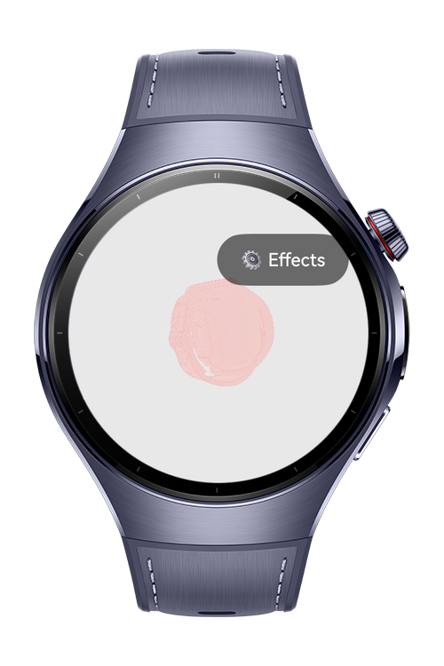
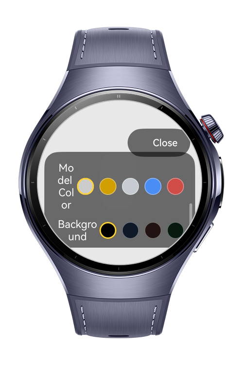
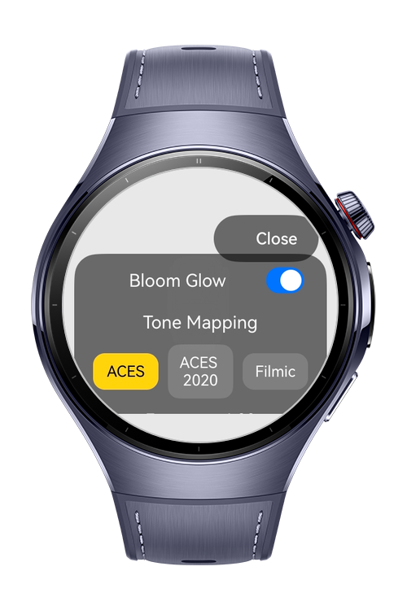
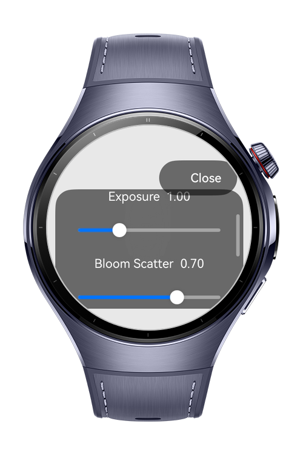

> **Note:** To access all shared projects, get information about environment setup, and view other guides, please visit [Explore-In-HMOS Index](https://github.com/Explore-In-HMOS/hmos-index).

# how-to-build-3d-post-processing

The `How to build 3d post processing` codelab demonstrates how to load a 3D model on a HarmonyOS smart wearable and drive its render pipeline live — tone mapping, bloom, vignette, color fringe and emissive glow — through `@ohos:graphics.scene`, all from a single scrollable effect panel on a small round screen.

# Preview

<div>




</div>

# Use Cases

* Live 3D model view: A GLB model is loaded into a `Component3D` via `Scene.load`, filling the whole screen behind a transparent gesture layer. A `PanGesture` drives yaw/pitch rotation of the model in real time, computed with a small hand-rolled quaternion helper (`QuatMath.fromYawPitch`) so the math stays isolated and unit-testable.
* One-tap look presets: Four named presetsCinematic, Vivid, Noir, Dream — are defined in a `PresetCatalog` and each bundles a full set of post-process values (tone type, exposure, bloom, scatter, glow, vignette, fringe). Tapping a preset copies its values onto the live `EffectParams` in one shot and re-renders.
* Tone mapping & exposure: Three tone curves (`ACES`, `ACES_2020`, `FILMIC`) are selectable as pill buttons, paired with an exposure slider (0.2–3.0) that feeds `ToneMappingSettings`.
* Bloom, glow & vignette: A bloom toggle plus scatter slider controls `BloomSettings`, while a separate glow slider drives the emissive intensity of the model's own material — since the GLB ships with no materials or emissive markers, the app assigns its own `MetallicRoughnessMaterial` and boosts its emissive factor so bloom has something bright to catch. Vignette and color fringe are each their own toggle + intensity slider, mapped to `VignetteSettings` and `ColorFringeSettings`.
* Camera zoom: A reverse slider (2.0–12.0, clamped) pushes the camera's Z position in/out without touching the model itself.
* Model recolor & backdrop swatches: Five model-body color swatches repaint the material's base color (converted sRGB→linear so it matches the 3D pipeline), and four background swatches recolor the `Stack` behind the model — both shown as small selectable circles with a highlighted border for the active choice.
* Auto-rotate & reset: A toggle spins the model on its own axis via a 16 ms interval timer (paused automatically if the user starts dragging), and a reset button restores every effect, camera and color value to its authored default in one call.

# Tech Stack

* Language: ArkTS / ArkUI
* Framework: HarmonyOS SDK 6.0.2(22)
* Tools: DevEco Studio
* Libraries:
    * `@kit.ArkUI`
    * `@kit.AbilityKit`
    * `@ohos:graphics.scene` (`Scene`, `Camera`, `Component3D`, `PostProcessSettings`, `ToneMappingSettings`, `BloomSettings`, `VignetteSettings`, `ColorFringeSettings`, `MetallicRoughnessMaterial`)

# Directory Structure

```
entry/src/main/
|---ets/
|   |---entryability/
|   |   |---EntryAbility.ets
|   |---entrybackupability/
|   |   |---EntryBackupAbility.ets
|   |---model/
|   |   |---EffectParams.ets          
|   |   |---EffectPreset.ets          
|   |---util/
|   |   |---QuatMath.ets              
|   |---viewmodel/
|   |   |---PostProcessViewModel.ets  
|   |---pages/
|       |---Index.ets                 
|---resources/
|   |---base/
|   |   |---element/
|   |   |   |---color.json
|   |   |   |---string.json
|   |   |---media/                    
|   |   |---profile/
|   |           |---main_pages.json
|   |---rawfile/
|           |---model.glb             
|---module.json5

```
# Constraints and Restrictions

### Supported Devices

* Huawei Watch 5

# License

How to build 3d post processing is distributed under the terms of the MIT License.
See the [LICENSE](LICENSE) for more information.
